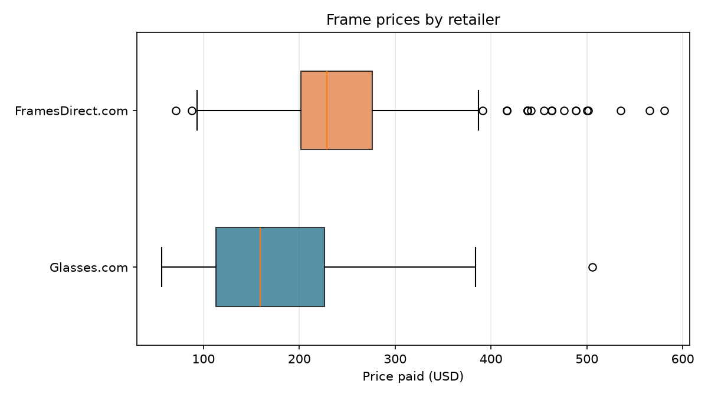
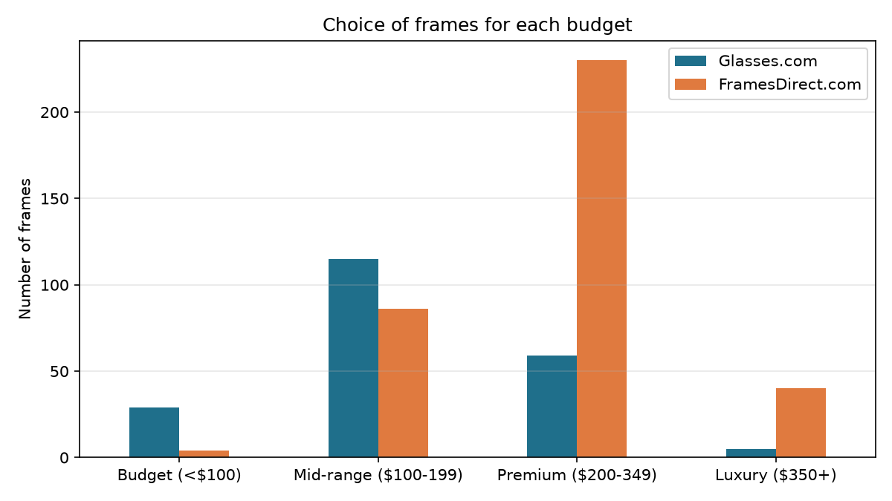
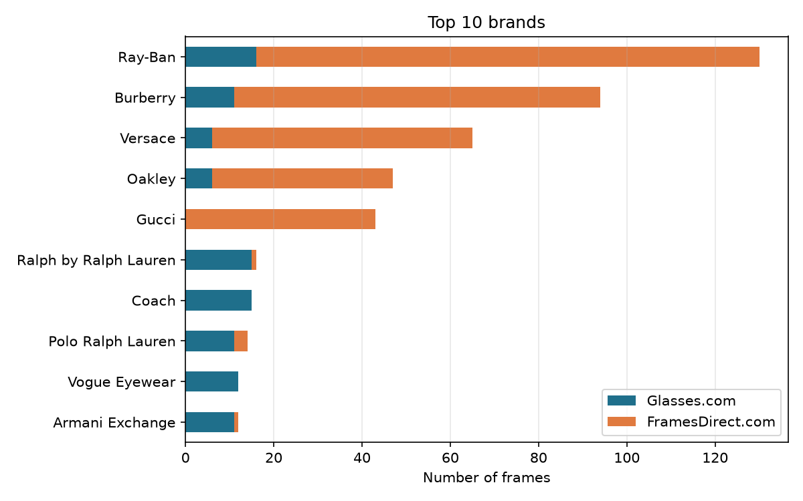
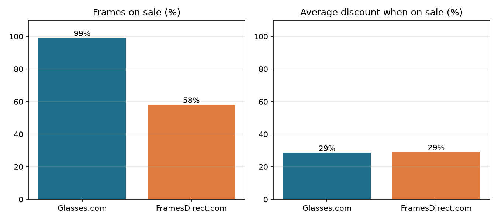

# Web Scraping for Smarter Eyewear Choices

**Frame & Lens case study: automating prescription-glasses data collection**
Tools: Python, Selenium, BeautifulSoup, pandas, SQLite, matplotlib

## The problem
Frame & Lens wants to offer patients more frame choices by bringing in products from two online
retailers, **Glasses.com** and **FramesDirect.com**. Their information is scattered and formatted
differently, and collecting it by hand is slow and error-prone. This project collects it automatically,
turns it into one clean, comparable dataset, and summarises what it shows.

## How it works

| Step | What happens | File |
|---|---|---|
| 1. Identify sources | Eyeglasses listing pages on both sites, inspected to find where each product detail sits in the HTML (see *Source analysis*). | `scraper.py` (`SITES`) |
| 2. Navigate with Selenium | Opens each listing page in Chrome, waits for the JavaScript product grid, scrolls to load every tile, then moves to the next page. | `scraper.py` |
| 3. Parse with BeautifulSoup | Reads each product tile and extracts brand, model, prices, colours, frame details and links. | `scraper.py` |
| 4. Clean & standardise | Converts prices to numbers, unifies brand spellings across sites, adds discount and price band, runs quality checks, removes duplicates. | `clean.py` |
| 5. Store | Saves a clean CSV and a SQLite database. | `clean.py` |
| Analyse | Produces 4 charts and a list of key findings. | `analysis.py` |

## Source analysis

| | Glasses.com | FramesDirect.com |
|---|---|---|
| Page used | `/gl-us/eyeglasses` | `/eyeglasses/` |
| Dynamic content | Product grid built with JavaScript | Product grid built with JavaScript |
| Pagination | `?pageNumber=N`; each page **repeats** the earlier pages' products and adds new ones | `?p=N`; about 24 frames per page, ~13,000 frames over ~540 pages |
| Product tile | `a.product-tile` | `div.prod-holder` (advert banners use the same class) |
| Data on the listing page | Brand, model, original and sale price, discount, colour count, "including lenses", badges | Brand, model, UPC, prices, colour swatches, colour name, plus a hidden details block with shape, material and gender |
| Anti-scraping | Bot protection; may show a "verify you are human" check | No checks seen during testing |

How the scraper deals with each:
- **JavaScript grids:** Selenium waits until product tiles exist instead of reading the page immediately.
- **Repeated products (Glasses.com):** products are tracked by ID; only new ones are kept, and the loop stops when a page adds nothing new.
- **Advert tiles (FramesDirect):** skipped because they have no product details block.
- **Bot checks:** the browser stays visible and the script pauses 60 seconds so the check can be completed.
- **Politeness:** random 2–5 second pause between pages.

## Data collected (`data/clean_products.csv`)
| Column | Meaning |
|---|---|
| `retailer`, `product_id` | Source site and product ID (UPC barcode) |
| `brand`, `model`, `product_name` | Standardised brand, model code, and brand + model |
| `list_price`, `sale_price` | Original and current price (USD) |
| `discount_amount`, `discount_pct`, `on_sale` | Saving in $ and %, and whether it's discounted |
| `price_band` | Budget (<$100), Mid-range ($100–199), Premium ($200–349), Luxury ($350+) |
| `colors_available`, `color_name` | Number of colour options; colour shown (FramesDirect) |
| `frame_shape`, `frame_material`, `gender` | Frame details (FramesDirect) |
| `includes_lenses` | Price includes lenses (Glasses.com) |
| `product_url`, `image_url` | Links to the product page and photo |
| `page`, `scraped_at` | Listing page number and collection time |

"Not listed" means the retailer doesn't show that value on its listing page.

## How to run
Requires Python 3.10+ and Google Chrome.

```bash
python -m venv .venv
.venv\Scripts\activate            # Mac: source .venv/bin/activate
pip install -r requirements.txt

python scraper.py      # ~15 min: collects about 500 frames  -> data/raw_products.csv
python clean.py        # cleans and stores                   -> data/clean_products.csv, data/eyewear.db
python analysis.py     # charts and findings                 -> charts/, data/findings.txt
```

Change `PAGES_PER_SITE` at the top of `scraper.py` to collect more or fewer frames.

Example query on the database (with [DB Browser for SQLite](https://sqlitebrowser.org/) or Python):
```sql
SELECT product_name, retailer, sale_price
FROM products
WHERE sale_price < 150 AND frame_shape = 'Round'
ORDER BY sale_price;
```

## Findings
See `data/findings.txt` and the charts below (generated by `analysis.py`).






## Limitations
- **Listing pages only.** Glasses.com doesn't show colour name, frame shape, material or gender on its
  listing pages, so those are "Not listed" for its frames.
- **No frame measurements.** Lens width, bridge and temple length are only on individual product pages.
- **No insurance information.** Neither listing page shows insurance eligibility.
- **Prices change.** Each run is a snapshot; both sites run frequent sales.
- **Website changes.** If a retailer redesigns its pages, the CSS selectors in the two `parse_`
  functions need updating. Using each site's most stable data (e.g. FramesDirect's hidden details block)
  keeps this rare, and Selenium downloads the right Chrome driver automatically.

## Next steps
- Visit each product page to add frame measurements and fill in Glasses.com's frame details.
- Run weekly and keep each run's prices to track changes over time.
- Match the same frame across both retailers by UPC to show patients the lower price.

## Responsible scraping
Only public product information is collected (no accounts, logins or personal data), with pauses
between pages. Check each site's terms of use and `robots.txt` before any commercial use.
